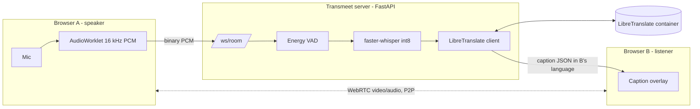
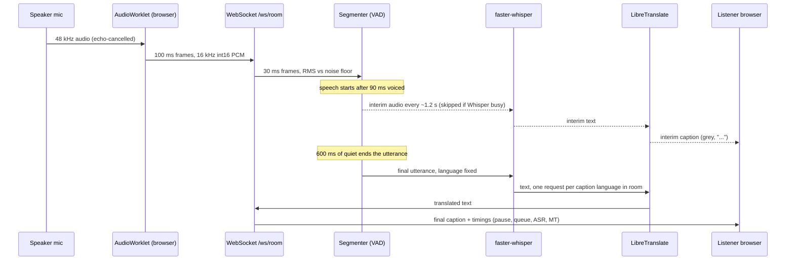

# Transmeet: presentation kit

Contents: (1) slide-by-slide outline with speaker notes, (2) viva / Q&A prep, (3) glossary.
Code references are `file:line` in this repository. Results slide numbers come from `docs/BENCHMARKS.md`, which is still being produced, so no figures are quoted here.

---

## Part 1. Slide outline

### Slide 1. Title
- **Transmeet: self-hosted video calls with live speech-translation captions**
- Your name, guide, department, date
- One-line tagline: "WebRTC + Whisper + LibreTranslate, on a CPU, with no paid API"

*Notes:* Introduce yourself and the one-sentence pitch: two people speak different languages, each reads captions in their own. Say upfront that you will demo it live.

### Slide 2. Problem and motivation
- Language differences block remote study, work and community meetings
- Zoom, Google Meet and Teams translated captions are paid-tier and cloud-only (RELATED_WORK #10-12)
- Open-source options mostly lack integrated multilingual support
- Workaround today: copy text into an external translator, which breaks the flow of conversation
- Gap: an affordable, self-hostable option for students and small teams

*Notes:* Quote the abstract's gap statement. Stress "affordable and self-hosted", not "better than Zoom".

### Slide 3. Objectives (mapped to the abstract)
| Abstract promise | Where it is delivered |
|---|---|
| WebRTC peer-to-peer video/audio | `app.js` `startPeer`, server only relays signalling (`main.py`) |
| Streaming Whisper ASR (local) | `asr.py` faster-whisper, utterance segmentation plus interim captions |
| Self-hosted LibreTranslate | `translate.py`, separate container |
| WebSocket caption loop | `/ws/{room}` carries audio in and captions out (`main.py`) |
| Two-person calls | `MAX_PEERS=2` (`config.py`, `main.py`) |
| At least two language pairs | Default five languages: en, hi, es, fr, de |
| Latency and accuracy benchmarks | `/api/stats`, `bench/accuracy.py`, `bench/latency.py` |

*Notes:* Walk the table left to right. Be honest on one row: "streaming" here means segmentation plus partial re-transcription, not token-level incremental decoding (slide 7).

### Slide 4. Related work (honest summary)
- Closest prior art: **voice-bridge**, a hobby project with WebRTC, WebSocket PCM, VAD, faster-whisper and Argos/Google Translate
- Others cover only part of the problem: WhisperLive and Skynet (ASR only), Jigasi (heavy Jitsi stack), LiveKit Agents (cloud STT in docs), meet-translate (paid APIs), SimulStreaming (wants a GPU, CPU too slow)
- Commercial: Zoom (~$5/user/month add-on), Meet and Teams (premium tiers)
- **What Transmeet adds over voice-bridge:** independent implementation with per-viewer caption language, interim captions, per-stage latency instrumentation, a reproducible benchmark suite, and one-domain Docker deployment
- **What it does not claim:** a new algorithm. The contribution is integration, measurement and deployability.

*Notes:* Say plainly that voice-bridge exists and the architecture is similar. The differentiators are engineering and evaluation, not novelty of idea.

### Slide 5. System architecture
- Browser A and B: camera/mic, WebRTC peer connection, AudioWorklet, caption overlay
- Server (FastAPI, one process, one port): signalling, VAD, faster-whisper, LibreTranslate client, stats
- LibreTranslate: private container, never exposed publicly
- Two planes: **media plane** (P2P video/audio) and **caption plane** (WebSocket through server)

*Notes:* Point out that video never touches the server; only a 16 kHz copy of the mic does. This is why captions survive a blocked P2P link.

### Slide 6. Life of one caption (sequence diagram)

*Notes:* Narrate once, slowly. Mention the timings object returned with every final caption, which is how latency is measured in the app itself.

### Slide 7. Module: capture and VAD
- **AudioWorklet** (`pcm-worklet.js`): box-filter downsample 48 kHz to 16 kHz, int16, posts 1600-sample (100 ms) chunks, about 32 KB/s
- **Segmenter** (`vad.py`): 30 ms frames (`FRAME=480`), frame is voiced if `rms > max(0.008, 3 x noise floor)` (`vad.py`)
- **Adaptive noise floor:** moves fast (rate 0.1) toward quieter frames, very slowly (0.001) upward, so steady hum is absorbed but speech is not (`vad.py`)
- **Start rule:** 3 voiced frames = 90 ms (`START_FRAMES`), with 300 ms pre-roll so the first syllable is kept
- **End rule:** `SILENCE_MS` = 600 ms of quiet (20 frames), or forced cut at `MAX_SEGMENT_S` = 10 s; utterances with under 250 ms of voice are discarded
- Trade-off: lower SILENCE_MS gives faster captions but cuts sentences at natural pauses

*Notes:* "Streaming ASR" in this project means VAD-driven utterance chunking plus interim captions. Say this yourself before an examiner does.

### Slide 8. Module: ASR (Whisper)
- faster-whisper (CTranslate2), **int8** on CPU, greedy decoding by default (`BEAM_SIZE=1`)
- **Language is fixed** from the speaker's setting, so no language-detection pass (`asr.py`)
- **Per-language model:** `WHISPER_MODEL_BY_LANG=hi=small` so only Hindi pays for the larger model (`asr.py`)
- **Interim vs final:** interims are greedy re-transcriptions of the utterance so far, first at 1 s and then every 1.2 s; finals allow one retry at temperature 0.4 (`asr.py`)
- **Interims are skipped while Whisper is busy** (`main.py`) because finals must not queue behind throwaway text on a small CPU
- **Filters:** drops low-confidence segments (`no_speech_prob > 0.6` and `avg_logprob < -1.0`), regex for known hallucinations ("thanks for watching"), and `collapse_repeats` for loops of 1-3 word units

*Notes:* Explain the busy rule as a priority policy: correctness of final captions beats freshness of partial ones.

### Slide 9. Module: translation and fan-out
- LibreTranslate (Argos models) over HTTP, async `httpx` client (`translate.py`)
- **Per-viewer fan-out:** the server collects the distinct caption languages in the room, translates once per language, and sends each viewer their own (`main.py`, `main.py`)
- LRU cache of 2000 sentences keyed by (source, target, text)
- Small fix-ups: strips the stray "." Argos adds after a Hindi danda (`translate.py`)
- If translation fails, the client shows the original text with "(translation unavailable)" instead of nothing

*Notes:* Fan-out is trivial with two people but the code is already per-language, not per-pair, so it generalises.

### Slide 10. Instrumentation and WebRTC
- Every final caption carries `audioMs, vadMs, queueMs, asrMs, mtMs, totalMs` (`main.py`)
- `/api/stats` returns mean, p50, p95 per stage plus ASR real-time factor (`main.py`)
- Transcript panel shows the breakdown live
- WebRTC: newcomer sends the offer, ICE candidates relayed over the same WebSocket; STUN by default, TURN optional via env (`config.py`)
- Connection state `failed` shows "media blocked by network (captions still work)" (`app.js`)

*Notes:* Instrumentation is what makes the latency claim defensible: you can show where every millisecond went.

### Slide 11. Tech stack and deployment
| Layer | Choice |
|---|---|
| Browser | WebRTC, AudioWorklet, WebSocket, vanilla JS (no build step) |
| Server | Python, FastAPI, uvicorn, NumPy, httpx |
| ASR | faster-whisper 1.2.1 on CTranslate2, int8, Whisper `base` (`small` for Hindi) |
| MT | LibreTranslate v1.6.2 (Argos), AGPL-3.0, separate container |
| Packaging | Docker Compose, one public service on port 8000 |
| Host | Dokploy with Traefik and Let's Encrypt, one domain |

- Only `transmeet` is public; LibreTranslate stays on the private network
- **HTTPS is mandatory:** browsers allow camera/mic only on `https://` or `localhost`, and `wss://` follows from it
- Whisper `base` and `small` are baked into the image; other sizes download to a volume
- One uvicorn worker because rooms are in memory and Whisper already uses all cores (`Dockerfile`)

*Notes:* If asked "why a single domain", the answer is simpler TLS, no CORS, and the WebSocket and API share the page's origin.

### Slide 12. Results
<!-- RESULTS: filled from docs/BENCHMARKS.md -->

- (Planned content: ASR WER/CER per language and model; MT BLEU/chrF for reference text vs ASR output; end-to-end caption latency mean/p50/p95 per pair; latency breakdown by stage.)

*Notes:* Method in one breath: FLEURS test set, 25 sentences per language, jiwer for WER, sacreBLEU for BLEU and chrF, live latency measured by two WebSocket clients. State the small sample size yourself.

### Slide 13. Live demo (script in Part 1b below)
- Two devices, one room, two languages (English to Hindi, then Hindi to English)
- Show: captions, interim text, latency chip, transcript panel, `/api/stats`
- Fallback if P2P video is blocked: captions continue through the server

*Notes:* Keep the demo to 4 minutes. Rehearse on the venue network beforehand.

### Slide 14. Limitations, future work, conclusion
- Limits: two participants; sentence-level captions (not word-by-word simultaneous); accuracy tied to model size; no authentication; in-memory rooms (single replica); CPU contention between rooms
- Future: SFU for multi-party calls, one ASR path per speaker, simultaneous translation, TTS voice-over, diarisation, meeting minutes, TURN bundled in Compose
- **Conclusion:** a fully open-source, self-hostable pipeline gives usable cross-language captions on a CPU server with no paid API, and the latency and accuracy are measured rather than assumed

*Notes:* End by returning to the abstract: prototype, two-person calls, more than two language pairs, benchmarks. Then invite questions.

---

## Part 1b. Live demo script

**Before the session (15 min earlier):** open the `https://` URL on both devices, allow camera/mic, check `/api/health` shows `"translator": true`, and speak one test sentence per language to warm things up. Use headphones on at least one device to avoid echo, and keep the devices in different spots (or mute one speaker) so the mics do not hear each other.

1. **Device A (laptop, projected):** open the site, name "Asha", *I speak* English, *Show captions in* English, room code from "new room". Join.
2. **Device B (phone or second laptop):** open the invite link (the copy-invite button), name "Ravi", *I speak* Hindi, *Show captions in* Hindi. Join. Point out "in call - peer-to-peer".
3. **Asha says:** "Hello Ravi, welcome to our project demo. Can you hear me clearly?" Show the grey interim text, then the final Hindi caption on B, with the original underneath.
4. **Ravi replies in Hindi:** "हाँ, मुझे आपकी आवाज़ साफ़ सुनाई दे रही है।" Show the English caption on A.
5. **Change a setting mid-call:** switch Ravi's caption language to English; say another sentence; show it changes (the `update` message, `main.py`).
6. **Show numbers:** the latency chip, one transcript entry's breakdown (pause + queue + ASR + MT), then `/api/stats` in a tab.
7. **Optional:** toggle the mic off mid-sentence to show the `flush` that finishes the sentence (`app.js`).

**Fallback plan:**
- *Video does not connect* (venue Wi-Fi blocks UDP/P2P): the status chip says "media blocked by network (captions still work)". Carry on: captions travel over the server WebSocket, and you can say your lines aloud. Alternatively switch one device to a phone hotspot, or configure TURN beforehand.
- *WebSocket blocked:* the page shows "reconnecting"; switch to a hotspot.
- *Translator still loading:* captions appear untranslated with a lobby warning; wait for `/api/health` to show `translator: true`.
- *Everything fails:* play a pre-recorded screen capture of a successful call.

---

## Part 2. Viva / Q&A prep

**1. Why WebRTC peer-to-peer and not an SFU?**
For two people, a mesh of one link is the simplest correct topology: no media server, lower latency, no server bandwidth for video. The server only relays SDP/ICE (`main.py`). An SFU (mediasoup, LiveKit) pays off at three or more participants, and is listed as future work. The abstract itself scopes the project to two-person calls.

**2. Why send audio separately over a WebSocket instead of using the WebRTC audio on the server?**
In P2P the server never receives the WebRTC media. To get it, the server would have to be a WebRTC endpoint (for example an SFU or a Python WebRTC stack) and decode Opus. The AudioWorklet instead gives clean 16 kHz int16 PCM, which is exactly what Whisper wants, over a plain WebSocket (`app.js`, `pcm-worklet.js`). Cost: about 32 KB/s extra upload per speaker. Benefit: the caption path is independent of the media path, so captions work even if video fails.

**3. How does your VAD work and what is the trade-off?**
Energy VAD on 30 ms frames. A frame is voiced if RMS exceeds both an absolute floor of 0.008 and 3x an adaptive noise estimate (`vad.py`). The estimate drops quickly and rises very slowly, so constant noise is absorbed (`vad.py`). An utterance opens after 90 ms voiced and closes after `SILENCE_MS` (600 ms) of quiet. Trade-off: a shorter silence window lowers caption latency by that amount but splits sentences at mid-sentence pauses, hurting ASR and translation context; a longer one is more accurate but slower. It is cheap but not noise-robust the way a neural VAD is; faster-whisper's built-in Silero filter (`asr.py`) gives a second pass inside each segment.

**4. Is this really "streaming" ASR?**
Not token-level streaming. It is VAD-segmented, utterance-level recognition plus interim captions produced by re-transcribing the growing utterance every ~1.2 s (`main.py`). Final captions arrive after the sentence ends. True simultaneous decoding (SimulStreaming) needs far more compute (RELATED_WORK #8).

**5. Why are interim captions skipped when Whisper is busy?**
There is one ASR worker by default (`ASR_WORKERS=1`). An interim costs the same compute as a real transcription, so running it while a final is waiting would delay the caption that matters. `maybe_interim` returns early if `asr.busy` (`main.py`), and stale interims are dropped if the final already went out (`main.py`).

**6. Why int8?**
CTranslate2 int8 quantisation roughly halves memory and speeds up CPU inference with little accuracy loss. faster-whisper's published benchmark (small model, 13 min audio, i7-12700K, 8 threads, beam 5) is 1m42s and 1477 MB for int8 against 2m37s and 2257 MB for fp32. That is a published figure, not our measurement; ours are in BENCHMARKS.md. Config: `WHISPER_COMPUTE=int8` (`config.py`).

**7. Why fix the language instead of auto-detecting?**
The speaker already declares it in the UI, so detection is redundant. Fixing it skips Whisper's detection pass (saves compute), avoids mis-detection on short utterances (a known weak spot of small models), and gives the correct source for LibreTranslate. Downside: if someone speaks the wrong language or code-switches, quality drops. They can change the setting mid-call.

**8. What does the latency consist of?**
`totalMs` = end of speech to caption sent = pause wait (`vadMs`, at least `SILENCE_MS`) + queue (`queueMs`) + ASR (`asrMs`) + MT (`mtMs`) (`main.py`). It excludes up to 100 ms of worklet buffering and network transit, which are not measured server-side. The live benchmark (`bench/latency.py`) measures from the last audio frame sent to the final caption received by a second client, so it includes the silence wait and the network. The pause is a design parameter, not compute.

**9. How did you measure accuracy?**
Offline with `bench/accuracy.py` on FLEURS test sentences (n-way parallel: the same sentence id exists in every language, so it gives both audio and reference translations). ASR: WER via jiwer (plus CER for Hindi) after lowercasing and stripping punctuation. MT: BLEU and chrF via sacreBLEU against the target-language FLEURS text, once from the reference source text (isolates MT) and once from ASR output (the real cascade). Limitation: 25 sentences per language is a small sample, read-speech FLEURS is cleaner than real calls.

**10. Why does Hindi need a bigger model?**
Small Whisper models are weaker on lower-resource languages and Devanagari, with more errors and repetition loops. `WHISPER_MODEL_BY_LANG=hi=small` loads a second model and routes Hindi speakers to it (`asr.py`, `asr.py`), so English stays on fast `base`. Cost: about 1 GB more RAM. The size of the gain is in BENCHMARKS.md.

**11. How do you deal with Whisper hallucinations?**
Several layers: Silero VAD filtering inside faster-whisper (`asr.py`); dropping segments with `no_speech_prob > 0.6` and `avg_logprob < -1.0` (`asr.py`); a regex for known phantom phrases such as "thanks for watching" (`asr.py`); and `collapse_repeats`, which caps runs of repeated 1-3 word units at two (`asr.py`). `condition_on_previous_text=False` also prevents error carry-over between segments.

**12. What about privacy and security?**
No cloud APIs: audio is processed on your own server and is not stored (the code writes no audio to disk; transcripts exist only in the browser unless the user downloads them). Honest caveats: the server does receive everyone's audio; the transcript text is written to the server log at INFO level (`main.py`); default STUN uses Google servers, which see participants' IP addresses; model weights are downloaded from the internet at build or first start. There is **no authentication**: anyone who knows or guesses a room name can join an empty room, and the only guard is the two-person cap (`main.py`). Room names from the UI are random with some entropy, but this is not access control. Rooms live in memory only (`main.py`). HTTPS/WSS is provided by the reverse proxy.

**13. How does it scale?**
It does not scale far, by design. Whisper is CPU-bound; with `ASR_WORKERS=1` all rooms share one decoder, so concurrent speech queues (visible as `queueMs`). The README suggests 2 workers on 8+ cores. Rooms are in process memory, so only one server replica works (`Dockerfile` runs one uvicorn worker). Scaling out would need sticky routing or a shared room store, and ideally a separate ASR service or GPU (`WHISPER_DEVICE=cuda`).

**14. What happens when NAT blocks peer-to-peer?**
STUN handles most home and office NATs. Strict networks (some campus Wi-Fi, mobile carriers) need a TURN relay, configurable with `TURN_URLS/USERNAME/CREDENTIAL` (`config.py`). Without TURN, the connection state becomes `failed`; the UI says media is blocked and the initiator calls `restartIce` (`app.js`). Captions are unaffected because they use the WebSocket. TURN is not bundled in the Compose file.

**15. What are the AGPL implications of LibreTranslate?**
LibreTranslate is AGPL-3.0. We run the unmodified upstream image as its own container and talk to it over HTTP, so it is a separate program and Transmeet's own code (MIT) is not a derivative work. Obligations would arise if we modified LibreTranslate and offered it to users over a network; then we would need to publish those changes. (This is the standard reading, not legal advice.) The Whisper weights are MIT.

**16. Why a custom energy VAD instead of Silero or WebRTC VAD?**
Zero extra dependency, microsecond cost per frame, and full control of start/end rules for the latency experiment. It is weaker with background speech and music. A neural VAD is a sensible upgrade; faster-whisper's Silero pass partly compensates.

**17. How do you keep captions in order and avoid duplicates?**
Each peer has a sequence number per utterance. `final_lock` serialises that speaker's finals (`main.py`); `finalized` marks the highest completed utterance so a late interim never overwrites a final (`main.py`, `main.py`). The client keys captions by `seg` id (`speakerId-n`), so an interim is replaced in place by its final (`app.js`). Empty finals clear a dangling interim.

**18. How does one speaker's caption reach each viewer in a different language?**
`translate_for_room` collects the distinct caption languages in the room, excluding the speaker's own, and translates once per language in parallel (`main.py`). `deliver` then builds a per-peer message with that peer's `tgt` and translated text (`main.py`). Viewers can change their caption language mid-call; the server just reads the updated value.

**19. Why not use a cloud ASR or LLM translator, which would be more accurate?**
The project's goal is a fully open-source, self-hostable, no-per-minute-cost pipeline (abstract). Cloud services would give better quality or lower latency but add cost, data leaving your control and vendor dependence. The architecture is modular, so the ASR or MT stage could be swapped.

**20. What would you do with more time?**
Run the benchmark on more sentences and real call audio; add a neural VAD; stream-friendly decoding for lower latency; bundle a TURN server; room passcodes and rate limits; an SFU plus per-speaker ASR for group calls; optional TTS voice-over.

---

## Part 3. Glossary

| Term | Meaning in this project |
|---|---|
| **WebRTC** | Browser API for real-time peer-to-peer audio/video; carries the call media |
| **SDP** | Session Description Protocol: the offer/answer text describing codecs and connection details; relayed via `signal` messages |
| **ICE** | Interactive Connectivity Establishment: process of finding a working network path between peers |
| **STUN** | Server that tells a peer its public address; defaults to Google's (`config.py`) |
| **TURN** | Relay server used when direct P2P fails; optional here, costs bandwidth |
| **Signalling** | Exchange of SDP and ICE candidates before a call; done over the app's WebSocket |
| **SFU** | Selective Forwarding Unit: media server for group calls; not used (future work) |
| **AudioWorklet** | Browser API for processing audio on a dedicated thread; used to produce 16 kHz PCM |
| **PCM** | Raw uncompressed audio samples; 16-bit mono at 16 kHz here |
| **VAD** | Voice Activity Detection: decides when speech starts and stops (`vad.py`) |
| **RMS** | Root-mean-square amplitude of a frame; the energy measure the VAD uses |
| **Whisper** | OpenAI's multilingual speech-recognition model family (tiny, base, small, ...) |
| **CTranslate2** | Fast C++ inference engine for transformer models; runs Whisper (via faster-whisper) and Argos |
| **int8 quantisation** | Storing weights as 8-bit integers: less memory and faster on CPU with small accuracy loss |
| **RTF** | Real-time factor: compute time divided by audio duration; below 1 means faster than real time (`/api/stats` `asrRealTimeFactor`) |
| **WER / CER** | Word / character error rate of a transcript against a reference; lower is better |
| **BLEU / chrF** | Translation quality scores (n-gram overlap / character n-gram F-score); higher is better; computed with sacreBLEU |
| **FLEURS** | Google's n-way parallel multilingual speech benchmark; same sentence in many languages |
| **LibreTranslate** | Open-source (AGPL-3.0) translation server built on Argos Translate models |
| **Interim / final caption** | Provisional text while speaking vs the committed sentence after a pause |
